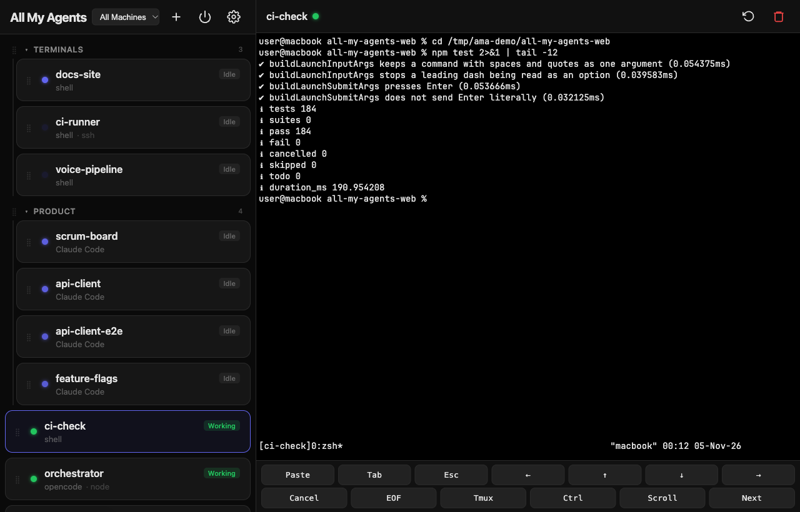
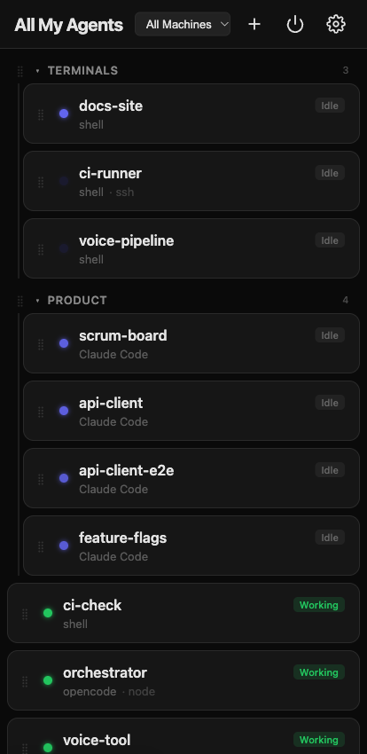

# All My Agents

A web interface for managing AI coding agent sessions (Claude Code, Cursor, Aider, Codex) across multiple machines. Works on both mobile and desktop, with auto-discovery of peers via Tailscale.

## Quickstart

```bash
git clone https://github.com/amack87/all-my-agents-web.git
cd all-my-agents-web
npm install
cp mesh.config.example.json mesh.config.json
```

Edit `mesh.config.json` and give the machine its name:

```json
{ "name": "my-macbook", "peers": [] }
```

Then start the server and open <http://localhost:3456>:

```bash
npm start
```

Every tmux session on this machine shows up in the sidebar — start one with
`tmux new -s my-agent` and it appears within a few seconds. To reach the
server from your phone or another machine, install
[Tailscale](https://tailscale.com/); peers running AMA are then discovered
automatically.

## UI Example

The desktop layout: the session list on the left, a live terminal on the right.



The same session list on a phone.



## Why

When running multiple AI coding agents in tmux across one or more machines, you need a way to monitor them and respond to input prompts from anywhere. All My Agents gives you a unified view of all sessions across your Tailscale mesh with full terminal access, status detection, and a speedrun mode for quickly triaging agents that need attention.

## Features

- **Multi-machine mesh** — auto-discovers other instances on your Tailscale network
- **Session list** with live status indicators (Working, Needs Input, Idle)
- **Full terminal access** via xterm.js + node-pty WebSocket connections
- **WebSocket proxy** — access terminal sessions on remote machines through the local server
- **Speedrun mode** — cycles through agents needing input, auto-advances after you respond
- **Client-side failover** — if the active server goes down, auto-switches to another
- **Session management** — create, kill, and restore tmux sessions (local and remote)
- **Remote targets** — reach a machine AMA cannot host (a Windows VM, for instance) by running the session over SSH, with the agent running natively there
- **Agent detection** — identifies Claude Code, Cursor, Aider, Codex, or shell
- **Responsive layout** — sidebar + terminal on desktop, card list on mobile
- **Zoom controls** — adjustable text size, persisted across sessions
- **PWA-capable** — installable as a home screen app on iOS/Android
- **Mobile-optimized toolbar** — Paste, Esc, Tab, Ctrl keys, scroll mode (tmux copy-mode)
- **Swipe-to-go-back** navigation from left edge
- **Long-press to delete** sessions
- **Claude session enrichment** — reads `~/.claude/projects/` metadata to show project paths
- **Auto-refresh** — session list polls every 3s, terminal status polls every 2s

## Architecture

```
Phone / Laptop Browser
    │
    │  HTTP + WebSocket over Tailscale VPN
    │
    ▼
Node.js server (Machine A)  ◄──── auto-discovery ────►  Node.js server (Machine B)
    │                                                        │
    ├── /api/sessions (local tmux)                          ├── /api/sessions (local tmux)
    ├── /api/mesh/sessions (aggregated from all peers)      ├── /api/mesh/sessions
    ├── /api/identity (machine name + peer list)            ├── /api/identity
    ├── /ws/terminal/:target (local PTY)                    ├── /ws/terminal/:target
    └── /ws/proxy/:peer/:target (proxied to remote)         └── /ws/proxy/:peer/:target
```

A session may also run a **launch command** instead of a default shell:

```
tmux pane on Machine A  ──ssh──►  agent running natively on a target
(session is hosted here;          (a machine that does not run AMA —
 the agent lives there)            e.g. a Windows VM)
```

A **peer** is the other shape: a machine that runs AMA itself and contributes
its own sessions. A **target** is a machine that only runs the agent.

## Requirements

- Node.js 22+
- tmux
- [Tailscale](https://tailscale.com/) (for remote access and peer auto-discovery)

## Setup

```bash
npm install
cp mesh.config.example.json mesh.config.json
```

Edit `mesh.config.json` with your machine name:
```json
{
  "name": "my-macbook",
  "peers": []
}
```

Peers are discovered automatically via Tailscale. You can also add manual peers:
```json
{
  "name": "my-macbook",
  "peers": [
    { "name": "desktop", "host": "100.x.x.x", "port": 3456 }
  ]
}
```

### Run

```bash
npm start          # production
npm run dev        # with --watch for auto-reload
```

### Run as a persistent service (launchd)

An example plist is provided in `setup/launchd-example.plist`. Replace the three
`__PLACEHOLDER__` values in it (`__REPO_PATH__`, `__NODE_PATH__`, `__LOG_PATH__`),
then:

```bash
cp setup/launchd-example.plist ~/Library/LaunchAgents/com.allmyagents-web.plist
launchctl load ~/Library/LaunchAgents/com.allmyagents-web.plist
```

Do not remove the `PATH` entry from the plist's `EnvironmentVariables`. launchd
gives a job a minimal `PATH`, and without it `tailscale` is not found — peer
auto-discovery then fails silently: the server starts, but the mesh stays empty
and nothing says why.

### Agent status adapter (opencode)

Instead of only scraping the screen, opencode can report its own lifecycle
(working / needs-input / idle) to the server as canonical status events. Copy
the adapter into opencode's plugin directory and restart opencode:

```bash
mkdir -p ~/.config/opencode/plugin
cp integrations/opencode/ama-status.js ~/.config/opencode/plugin/
```

Newer opencode builds read `~/.config/opencode/plugins/`; a project-local
`.opencode/plugin/` copy works the same way. The adapter is standalone and
fails open — if the server is down, opencode is unaffected and the server
falls back to screen detection.

**opencode 1.19 and later load a plugin's _default_ export.** A plugin file
with only named exports is rejected with `Plugin must export a default
definition with an id and an effect or setup function`, and opencode says
nothing about it in the UI — the failure is only in
`~/.local/share/opencode/log/opencode.log`. The adapter in this repo exports
both ways, so it loads on every version. If you write your own plugin, do the
same: `export default MyPlugin` next to the named export.

See `docs/adr/0008-opencode-plugins-export-a-default.md`.

It posts to the local server (`ALL_MY_AGENTS_PORT`, default `3456`). To point
it elsewhere, set `ALL_MY_AGENTS_URL` (e.g. `http://100.x.x.x:3456`) in the
environment opencode runs in.

If the pane was launched by AMA, the adapter also sends the pane's surface
token, so the server identifies the session exactly instead of matching a
session id that anything else could guess.

### Superwhisper notifications (per session)

The [Superwhisper](https://github.com/superwhisper/opencode-superwhisper)
plugin pops up whenever an agent finishes. That is helpful on one session and
noise on the other nine, so `integrations/opencode/superwhisper-optin.js`
makes it a per-session choice.

```bash
cp integrations/opencode/superwhisper-optin.js ~/.config/opencode/plugin/
```

Then, inside a session, run `/enable-superwhisper` to be alerted for that
session and `/disable-superwhisper` to stop. The choice lasts for that
session and survives a restart. A session you have not enabled is muted from
its first prompt.

It works by writing the marker file the Superwhisper plugin already reads
(`/tmp/superwhisper-agent/disabled-<session id>`), so the third-party plugin
is never patched and keeps working after an update. The two slash commands
have to be registered in opencode's config as well:

```json
{
  "command": {
    "enable-superwhisper": {
      "description": "Alert me with Superwhisper when this session finishes",
      "template": "Reply with the single word: superwhisper on"
    },
    "disable-superwhisper": {
      "description": "Stop Superwhisper alerts for this session",
      "template": "Reply with the single word: superwhisper off"
    }
  }
}
```

### Agent status adapter (Claude Code)

opencode identifies itself by its registry session id. Claude Code has no such
id, so the server mints a **surface token** when it launches a pane and exports
it into the pane environment as `AMA_SURFACE_TOKEN`. Claude's hooks run inside
that pane, inherit the token, and POST canonical events that carry it — so the
status still arrives as an event rather than a screen-scrape.

Install by merging the `hooks` block from
`integrations/claude/settings.example.json` into `~/.claude/settings.json` (or a
project `.claude/settings.json`), changing each command path to the absolute
path of `integrations/claude/ama-status-hook.js`:

```json
{
  "hooks": {
    "Stop": [
      { "hooks": [{ "type": "command",
        "command": "node /path/to/all-my-agents-web/integrations/claude/ama-status-hook.js" }] }
    ]
  }
}
```

The example covers `SessionStart`, `UserPromptSubmit`, `PreToolUse`,
`PostToolUse`, `Notification`, `Stop`, and `SessionEnd`. A `PreToolUse` on
`AskUserQuestion` or `ExitPlanMode` is reported as `needsInput` (Claude is
waiting on you); other tools report as activity. The hook fails open — with no
token, or with the server down, Claude is completely unaffected and the server
falls back to screen detection.

Surface tokens only exist for panes AMA launches itself (via the New Session
button or session restore). A Claude Code pane started by hand has no token and
keeps using screen detection.

## Remote targets

A session may run a **launch command** instead of a default shell. That is how
AMA reaches a machine it cannot host natively: the pane runs an `ssh` client,
and the agent on the far side runs natively. On a Windows VM that means a real
Windows process, on real Windows, with CRLF checkouts, `.cmd` shims, `cmd.exe`
quoting and Defender behaving exactly as they will for an engineer.

Targets are configured in `mesh.config.json`:

```json
{
  "name": "my-macbook",
  "peers": [],
  "targets": [
    {
      "name": "windows-vm",
      "label": "Windows 11 VM",
      "host": "192.168.64.2",
      "user": "<windows-user>",
      "identityFile": "~/.ssh/ama_windows_ed25519"
    }
  ]
}
```

`port` is optional (default 22), and `host` may be an `~/.ssh/config` alias. The
command is built on the server from this entry, so the browser never supplies a
command line, and the target is re-resolved at launch time — changing a host or
key takes effect without recreating the session.

Start a session on a target from the new-session dialog, or over the API:

```bash
curl -X POST http://127.0.0.1:3456/api/sessions \
  -H 'content-type: application/json' \
  -d '{"name":"win-agent","target":"windows-vm"}'
```

`GET /api/targets` lists the configured targets.

The one-time setup on the Windows machine — OpenSSH, the toolchain, the status
adapter — is scripted in [`setup/windows/`](setup/windows/README.md). AMA itself
never runs on Windows. See
[ADR 0002](docs/adr/0002-windows-via-ssh-target.md) for why, and
[ADR 0004](docs/adr/0004-pane-is-a-shell.md) for how the command reaches the
pane.

## Configuration

| Variable | Default | Description |
|----------|---------|-------------|
| `ALL_MY_AGENTS_PORT` | `3456` | Server port |
| `ALL_MY_AGENTS_URL` | `http://127.0.0.1:3456` | Base URL an agent adapter posts status events to (on the machine running the agent) |
| `ALL_MY_AGENTS_LOG_DIR` | `~/.local/state/all-my-agents` | Where the session registry and `server.log` live |
| `OPENCODE_BIN` | `~/.opencode/bin/opencode` | Path to the opencode binary used for session resume |
| `CLAUDE_BIN` | `~/.local/bin/claude` | Path to the Claude Code binary used for session resume |
| `ALL_MY_AGENTS_REGISTRY_POLL_MS` | `30000` | How often the live session registry is re-synced |
| `ALL_MY_AGENTS_RESTORE_DELAY_MS` | `10000` | Delay after server start before replaying the session registry |

## Access

From any device on your Tailscale network: `http://<tailscale-ip>:3456`

## Status Detection

The server captures the last 25 lines of each tmux pane and pattern-matches to determine agent state:

| Status | Detection |
|--------|-----------|
| **Working** | "esc to interrupt", token/timing counters |
| **Needs Input** | "esc to cancel", y/n prompts, Allow/Deny dialogs |
| **Idle** | Shell prompt visible (❯, $, #, %) |

## Speedrun Mode

Speedrun prioritizes sessions needing input across all machines. After you respond to an agent (press Enter), it detects the agent starting to work and shows a 3-second countdown before auto-advancing to the next session. Tap the overlay to skip the countdown.

## Security

- All proxy routes validate the target peer against the discovered/configured peer list
- Arbitrary host proxying is rejected (no open proxy)
- Peer session data is schema-validated (allowlisted fields only)
- tmux target parameters are validated against a strict regex
- WebSocket proxy buffers are capped to prevent memory exhaustion
- Connections are accepted only from trusted sources — loopback, Tailscale, and the VM bridge — checked at the TCP level before any HTTP or WebSocket handling sees them. The server listens on `0.0.0.0` so it keeps working when Tailscale arrives late, but a connection from anywhere else is dropped. See [ADR 0003](docs/adr/0003-trusted-source-gate.md).
- There is no HTTPS. The trusted-source gate, not transport encryption, is what keeps port 3456 off the public internet.
- Cross-origin requests are refused unless the `Origin` is this machine's own name, a configured mesh peer, or this machine's **full** MagicDNS name — machine and tailnet, matched whole, because another tailnet can publish a name that starts with the same short hostname — and the port has to match too. WebSocket upgrades are checked the same way, because CORS does not apply to them, so a page on another site cannot drive the local server. See [ADR 0005](docs/adr/0005-origin-allowlist.md).
- There is no authentication. Anything that can reach the server can drive a terminal, so the trusted-source gate and the origin allowlist are the only defences — do not weaken either to make something reachable.
- Every value that reaches the markup is escaped, quotes included. A session name arrives from a peer machine over the mesh and lands in `data-` attributes; a name containing a quote would otherwise close the attribute and become markup, and script running in the AMA origin can then drive the API.
- Two things are deliberately *not* defended, because defending them would not help: session creation is not rate-limited (the same endpoint accepts a command that runs in a pane, so the origin allowlist is the control that matters, not a cap), and the surface token is briefly visible in `ps` to the same user (tmux cannot set a pane environment variable without passing the value in its argv, and the alternatives put it in the scrollback and the shell history). See [ADR 0007](docs/adr/0007-what-the-server-does-not-defend-against.md).

## Known Issues

- **node-pty compatibility**: The stable node-pty 1.1.0 fails with `posix_spawnp` on Node 22 / macOS ARM. Must use beta 1.2.0-beta.11.
- **TMUX env stripping**: When the server itself runs inside tmux, the `TMUX` and `TMUX_PANE` env vars must be stripped before spawning `tmux attach`, or it will refuse to nest.

## License

MIT — see [LICENSE](LICENSE).
